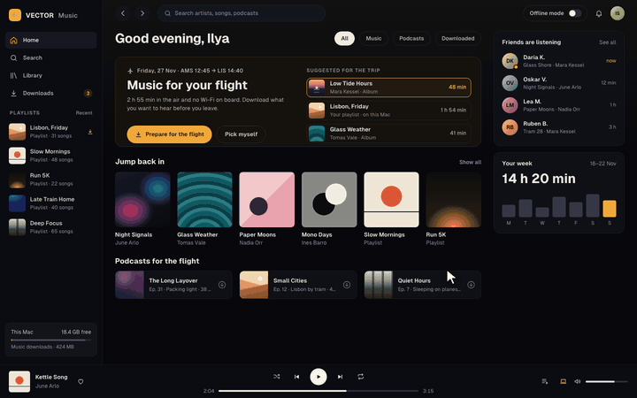

# Music Trip

**A whole music app screen. Download an album and its twelve waveforms fill with amber one after another; switch to offline and it still plays.**



**Live demo:** [veraetogrex-portfolio.github.io/music-trip](https://veraetogrex-portfolio.github.io/music-trip/) · **Mockup:** [full-screen version](https://veraetogrex-portfolio.github.io/music-trip/mockup/music-trip.html)

A desktop screen of VECTOR Music, the night before a flight from Amsterdam to Lisbon. The home page suggests music for the trip; the album page lists twelve tracks, each with its own waveform. Press Download album: track by track the waveform pours amber from left to right, the next one starts while the previous one is finishing, a check lands on every finished row and the counter on the right climbs from 0 to 12 of 12. Downloads shows the album first with Just added. Turn on Offline mode: everything that is not on this Mac dims, and the album still plays, with "Offline · from this Mac" in the player.

## Use it

Three files, no build step, no dependencies:

```
index.html   page that hosts the screen
style.css    styles, all scoped to .vm
script.js    screen, data, download cascade, offline and player
```

Download the repo and open `index.html`, or copy the three files into your project and put `<section class="vm"></section>` where the screen goes. The script turns every `.vm` on the page into the app.

## Try it

- On Home, click Prepare for the flight or the Low Tide Hours suggestion: the album opens.
- Click Download album. The waves fill one after another and the button reads Downloading · 5 of 12. Pressing it again during the cascade does nothing.
- When 12 of 12 lands, the Downloads badge turns to 4 and the album pin appears on the cover.
- Open Downloads: Low Tide Hours lands first with Just added, the flight bar shows how much music you have for 2 h 55 min in the air.
- Switch Offline mode: a banner appears, playlists and suggestions that are not downloaded dim.
- Click any downloaded track: it plays from this Mac. Offline, a track that is not downloaded does not start.
- Keyboard: Tab through the controls, Enter on Download album starts the download.

## Make it yours

At the top of `script.js`:

- `ALBUM`: title, artist, year, size in MB and the twelve tracks (title, length, plays).
- `LISTS`, `TRIP`, `SHELF`, `PODS`, `FRIENDS`, `ON_MAC`, `MORE`: the playlists, suggestions and shelves of the other screens.
- `wave(i)`: each track's waveform is deterministic noise by track number; replace it with real peaks if you have them.

In `download()`: `STAGGER` is how many ms after the previous track the next one starts, `FILL` how long one waveform takes to fill.

Colours live in the custom properties at the top of `style.css` (`.vm`): `--amber` for downloaded waves and checks, `--bg`, `--panel`, `--side` for the surfaces. Covers are drawn in CSS gradients (`.c-low`, `.c-sun`, …), no images.

## What's in `mockup/`

The full 1440×900 screen the reels were shot from:

- `mockup/music-trip.html` — interactive. `D` plays the demo, `R` resets.
- `mockup/music-trip.autoplay.html` — the scripted loop the reels were recorded from.
- URL flags: `?part=2` starts with the album already downloaded (the offline reel), `?frame` puts the screen in a browser window, `?clean` hides the control panel, `?once` plays the demo once.

The mockup loads the same `style.css` and `script.js` from the root, plus a shared stage runtime and bundled fonts from `mockup/_shared/`. The component in the root doesn't need any of it.

---

Components 36 and 37 of a series. New one every day on Instagram [@veraetogrex_portfolio](https://www.instagram.com/veraetogrex_portfolio/) · all components: [github.com/veraetogrex-portfolio](https://github.com/veraetogrex-portfolio)

MIT licensed.
